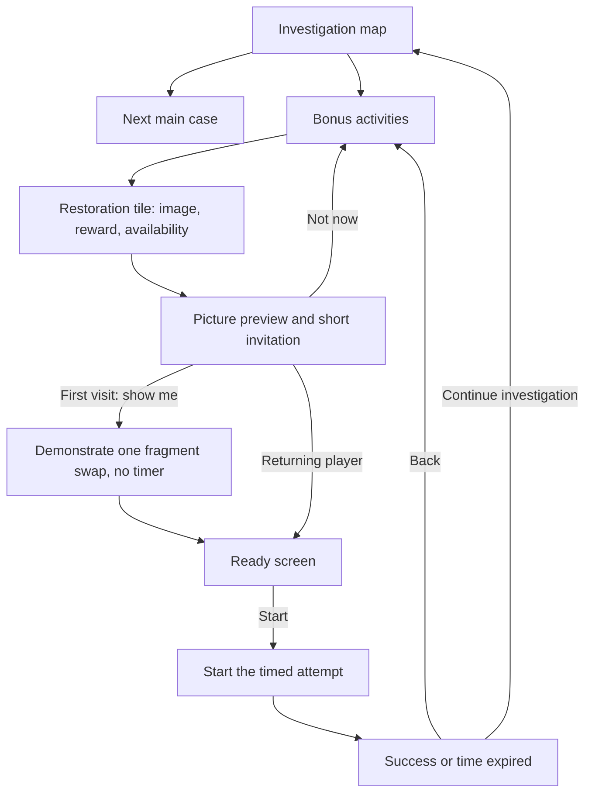

# Seasonal screens, daily prompts and optional activities

**Follow-up:** the user corrected the emphasis on permanent optional entries.
[Experience decisions](Experience_Implementation_Decisions.md) supersede that
part of this historical research and record the now-implemented first pass:
cohesive mobile cards, short practiced lessons and an earned booster challenge.

Research recorded 11 November 2026, before implementation. User request: study
more Candy Crush Saga screens and record what to learn from them, particularly
season changes, daily instructions, transitions before play, side-game discovery
and tutorials outside the match board. The user reports that image restoration
has become a nuisance. This document proposes changes; none are applied here.

## Evidence and limits

Ten downloaded references were visually inspected, including an animated guide. Browse the
[illustrated reference index](../references/candy-crush/README.md). Official help,
King staff announcements and historical player-posted screenshots are labeled
separately. The examples span different versions and accounts. They establish
screen composition and documented rules, not a universal startup sequence.

No live app session was recorded. The official Daily Treat attachment is an
animated GIF: 234 frames, 7.81 seconds of encoded playback. Sampled frames show its
activation, reward overlay and subsequent extra-ad offer. That guide does not
establish mandatory real-device waiting time, sound synchronization or today's
startup sequence. Transitions between the other static examples, dismissibility
on every variant and live popup frequency remain unverified. Suggested flows
below are our proposals unless explicitly identified as observed in the GIF.

## Recorded patterns

### 1. A season changes the environment, not just its explanatory text

The [current Game On announcement](https://community.king.com/en/candy-crush-saga/discussion/597411/game-on-season-is-coming-to-candy-crush-saga)
describes an arcade theme across the main menu, loading screen and level
backgrounds, alongside collection and league activities. Its date range is
9 November–6 December. The saved image is promotional artwork, not proof of the
exact in-app season-opening card.

**Lesson:** our chapter/season should have a recognizable place, palette, landmark
and short title. Story information alone does not make a transition feel new.
Our story seasons are progression-based; do not turn them into expiring calendar
events simply because Candy Crush also runs timed promotional seasons.

**Proposed screen:** chapter artwork, title, one short story hook, Continue and a
clear way to skip the presentation. Full story remains in the case file. Present
on first entry into the unlocked chapter, not every map visit or scroll across it.

### 2. A daily instruction can be a visual explanation of the reward loop

The saved [Daily Stamps introduction](https://candycrush.zendesk.com/hc/en-us/articles/28189843882013--Daily-Stamps)
shows characters stamping a card beside a chest, with one short explanation and
a Play action. The official guide distinguishes earning a daily stamp from
filling the card to unlock its chest. The older Daily Win tile in our events-hub
reference should not be presented as the current Daily Stamps design.

**Lesson:** show today's task, the stamp/card progress and the reward visually.
Do not use a daily-benefit screen primarily to send players to a different game.

**Proposed screen:** a card with today's main-game task and visible reward, with
Play next case as the main action. A separate Bonus activities entry can contain
restoration. A daily stamp should remain obtainable through the main game.

### 3. Reward introduction and reward result have different jobs

The historical [Daily Treat Machine guide](https://candycrush.zendesk.com/hc/en-us/articles/4402467400849--Daily-Treat-Machine)
documents an opening-game reward feature. The saved introduction uses an
illustrated machine, progress meter and Start action. A separate, later-version
[reward-result screenshot](https://community.king.com/en/candy-crush-saga/discussion/503332/i-039-m-liking-the-new-daily-treat-machine)
isolates the awarded booster and its duration above Claim.

The official GIF's sampled sequence is: introduction → Start gesture → machine
activation → dimmed background and isolated reward/Claim overlay → extra-ad
offer with a close control. The screen retains its recognizable background while
changing focus. This is an observed historical sequence, not a recommendation to
add an ad prompt or to require 7.81 seconds of animation in our game.

**Lesson:** before an activity, explain the opportunity; afterwards, clearly show
what was actually earned. Avoid a long reward-rules paragraph on both screens.
These two saved images are not consecutive frames from the same release.

**Proposed sequence:** task/invitation → actual play → earned reward → return to
the previous destination. Apply a reward once and preserve it if the presentation
is closed. A preview must never look like an already granted reward.

### 4. Introduce a challenge with its reward and one intelligible condition

The [Candy Royale start screen](https://candycrush.zendesk.com/hc/en-us/articles/4404903647517--Candy-Royale)
places a large prize cup above a concise consecutive-win condition. Its separate
historical rules overlay uses a simple illustrated progression between short
rule sections. The screenshots show different required win counts; those are
variants, not a mechanic to copy literally.

**Lesson:** answer what the activity is, what to do, what can be earned and when
it starts. Keep extra rules behind an information control.

**Caution:** the official guide currently says Royale cannot be opted out of.
Our bonus-game design should explicitly allow declining; do not infer that every
Candy Crush invitation has a Later button just because some other screens close.

### 5. Bonus progress can be understood from objects and counters

The saved [Chocolate Box selection screen](https://community.king.com/en/candy-crush-saga/discussion/394289/chocolate-box)
uses chocolates as selectable tasks and shows rewards above them. The
[official guide](https://candycrush.zendesk.com/hc/en-us/articles/360020946198--Chocolate-Box)
describes an initial popup and an Events-tab entry.

**Lesson:** introduction and persistent discovery can coexist. A short introduction
does not require a repeated full-screen explanation whenever progress changes.

**Proposed behavior:** one-time discovery, then a stable Bonus activities tile
showing thumbnail, available/resume state and reward. Ordinary progress updates
belong in that tile or a brief passive indicator, not a modal queue.

### 6. A rewards track is a progress view, not the opening tutorial

The saved [Season Pass screen](https://candycrush.zendesk.com/hc/en-us/articles/7897323489693--Season-Pass)
shows an illustrated header, countdown, milestone track, visible reward objects,
distinct Free/Premium columns, information and close controls. It is a detailed
progress destination, not evidence of a particular season-opening sequence.

**Lesson:** keep announcement, explanation and progress browsing distinct. This
research does not propose adding a paid pass, purchasing controls or deadlines
to Save The Baby. We can use illustrated progress for existing rewards instead.

### 7. Side activities should have an understandable connection back

The historical [Adventure Path staff explanation](https://community.king.com/en/candy-crush-saga/discussion/422242/what-is-adventure-path)
describes alternate tracks rejoining the main map, while retaining won progress.
The saved picture is promotional. It does not show a complete tutorial.

**Lesson:** explain whether the activity advances the main investigation or only
earns optional coins/art. Never imply that a picture puzzle unlocks a required
case if it does not. Return players to the place from which they entered.

### 8. Do not copy the interruption burden

The historical [events-hub reference](https://community.king.com/en/candy-crush-saga/discussion/431808/candy-royale)
uses separate illustrated tiles with counters/timers rather than putting every
activity's complete rules on one screen. It is useful as a discovery pattern.

However, [players also complain on King Community about repeated popups](https://community.king.com/en/candy-crush-saga/discussion/229447/how-can-i-get-rid-of-all-the-pop-up-windows-in-candy-crush).
That thread is qualitative evidence of frustration, not a measurement of current
popup frequency or all players' experience. Attractive individual screens do
not justify delaying access to the main game with several of them.

## What the current restoration implementation actually does

Code inspected: `scripts/ui/CampaignMap.gd`, `scripts/ui/RewardsHub.gd`,
`scripts/ui/PortraitPuzzle.gd`, `scripts/rewards/DailyActivities.gd`,
`scripts/game/Game.gd`, `configs/daily_activities.json`.

Confirmed:

- The map has a persistent full-size Restore portrait/Resume portrait button.
  The footer containing it and other controls reserves 460 logical units, about
  36% of the base 1280-unit viewport height; restoration is only part of that area.
- The daily briefing page's prominent Restore evidence action enters the puzzle.
  Yet completing a main case already earns the daily stamp. The destination can
  therefore make the puzzle seem more necessary than the rules actually require.
- For a fresh attempt, the entry screen emphasizes coins, piece count and time.
  It does not show the image to be restored or demonstrate a fragment swap.
- An active attempt bypasses that entry screen and resumes the puzzle directly.
- Starting creates a real-time deadline immediately. Opening View reference,
  opening a menu or leaving the activity does not pause it. Reading help costs
  part of the attempt's time.
- The puzzle has a reference image and a short swap sentence, but no guided
  first interaction before the paid-in-time attempt begins.
- Difficulties rotate between 3×3/120 seconds, 4×4/180 seconds and 5×5/240 seconds.
  All have the same configured base reward of 15 coins. A daily-stamp bonus can
  be added on completion if the stamp has not already been earned.
- The picture pool expands beyond portraits to tile icons, boosters and obstacle
  art. Recognizability and enjoyment may vary; this is a playtest question.
- Availability resets in 12-hour UTC slots; the attempt ends at the earlier of
  its deadline or the slot boundary. A near-boundary start can have less than the
  advertised difficulty duration. The current entry preview advertises the full
  duration, so this needs explicit treatment in a later implementation.
- In normal game code, entry is wired from the map button and rewards hub.
  Developer-screen controls also expose it. No automatic launch on ordinary
  startup, case completion or chapter change was found in those call sites.

The user's nuisance report is accepted. The static trace does not establish
whether a particular unexpected repeat-opening bug occurred in a running build.
Prominence, reward navigation and timed help are confirmed problems to address;
unexpected opening frequency needs runtime reproduction before claiming a cause.

## Proposed restoration flow — not yet applied

- Label the activity Optional bonus and show the actual picture, difficulty,
  exact playable time and reward before Start. Preview/Not now must not consume
  the slot, start a deadline or use a life.
- First-use coaching: demonstrate a wrong fragment being swapped into place,
  highlight the improvement, then invite the player to try one swap. Keep it
  brief and skippable. Reopen it through How to play; respect Tutorials off.
- Start time only after explicit Start. For help during an attempt, decide a
  consistent pause rule before implementation. Proposed rule: pause only while
  the built-in instructional/reference overlay is open and the app is focused;
  backgrounding still consumes time. This changes deadline accounting and needs
  tests, not just a changed label. An alternative is unlimited untimed practice.
- Resolve the slot-boundary mismatch: either decline new starts too near reset
  with clear wording, show the actual shorter time before confirmation, or allow
  a started attempt its full advertised duration. Choose a single fair rule.
- Keep daily progress and restoration separate. Main-case completion still
  qualifies for stamps. Do not create mandatory restoration steps or silently
  start a puzzle after claiming a daily reward.
- Review whether harder puzzles deserve larger rewards and whether all source
  images are recognizable enough. Do not alter reward amounts during this audit.
- Offer a clearly visible exit and retain a legitimate active attempt. Do not
  turn closing a bonus activity into an immediate reopening prompt.

## Proposed presentation and interruption rules

| Situation | Proposed presentation | Frequency and return behavior |
| --- | --- | --- |
| First entry into an unlocked story chapter | Artwork, chapter title, short hook | Once per chapter; dismissible; return to selected case/map |
| First encounter with a bonus activity | Image-led invitation with Play/Not now | Once per activity version; remember dismissal |
| First attempt at a new mechanic | One short demonstrated interaction | Only when needed; tutorial preference respected |
| Today's task available | Compact daily card or badge | Available from rewards; no automatic full-screen instruction queue |
| Ordinary bonus progress | Tile counter or passive progress animation | No blocking popup after every case |
| Reward actually earned | One compact reward result | Grant once; no repeated replay of the same claim |
| Several notices become eligible together | Map immediately, one small optional summary | Do not stack modal invitations ahead of Play |
| Returning from account/settings/help | Return to original context | No season/bonus introductions triggered merely by navigation |

For motion, propose short entrances and brief count/reward animations that never
delay the next action. Reduced-motion support, sound pairing, exact durations and
screen-to-screen choreography are future design work; they were not measured
from these screenshots. Story dialogue can retain more expressive presentation
than functional instructions. Use our own characters and artwork.

## Review before implementation

1. Review the saved screenshots and these flows; agree which existing main-game
   path must remain immediate and how restoration's timer should behave.
2. Create phone-scale screen sketches for a chapter transition, daily card,
   bonus hub, restoration invitation, demonstration and result.
3. Implement the chosen flow, then verify persisted introduction/dismissal state,
   tutorial preference, no timer/slot consumption before Start, background/help
   timing, reset-boundary starts, active-attempt resume and single reward grants.
4. Inspect 320/360/390/412-wide phone presentations. Check that Not now, Back and
   Continue investigation remain visible; test repeated map visits and relaunches
   without promotional queues. Record taps from launch to the next main case.

No gameplay, timer, economy, navigation or tutorial behavior was changed for this
research task. The previous blocker edits remain separate working changes.
